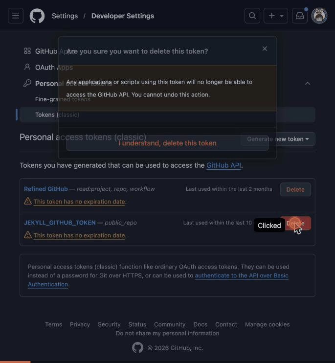
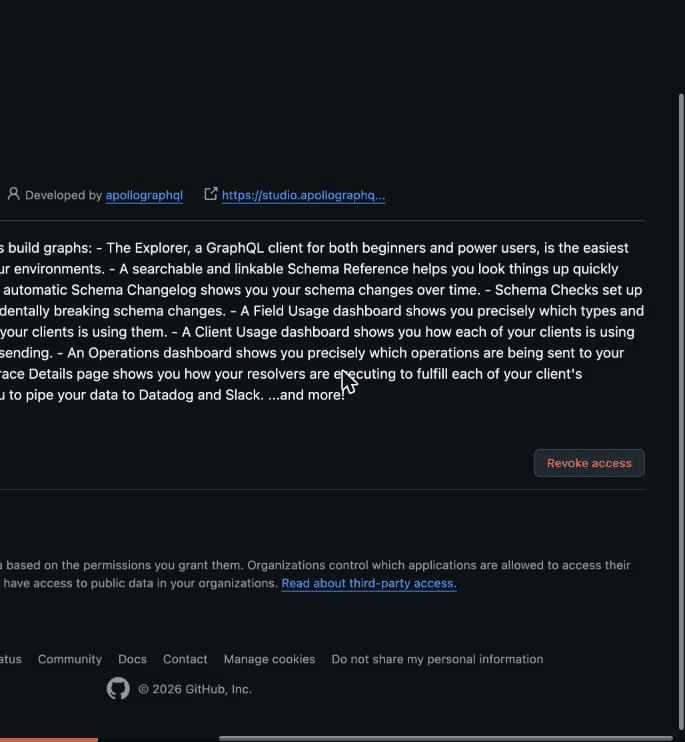
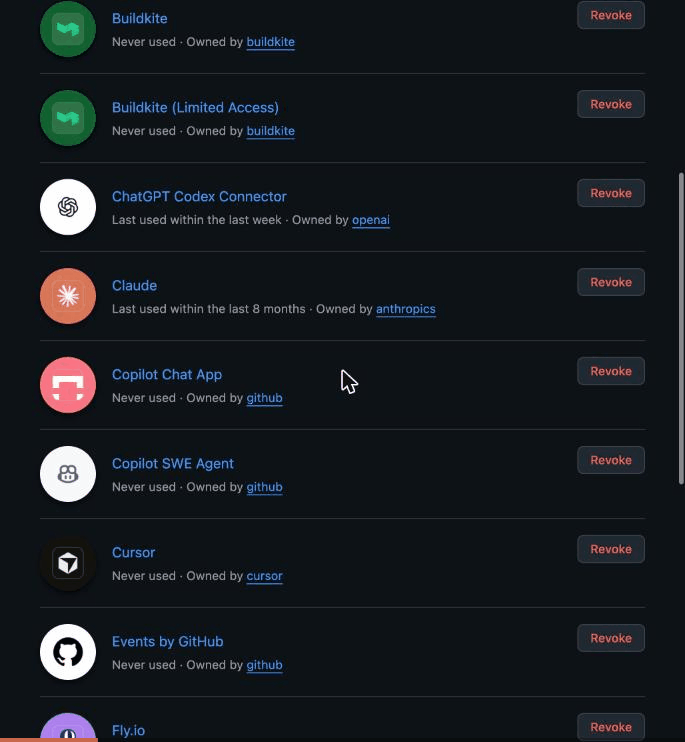
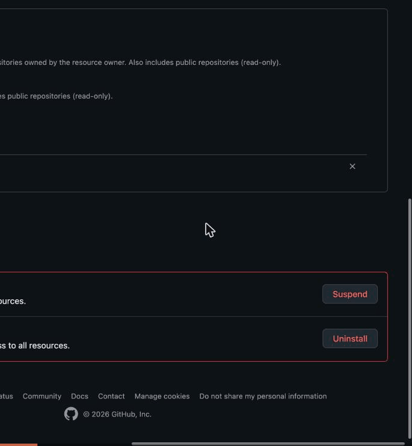
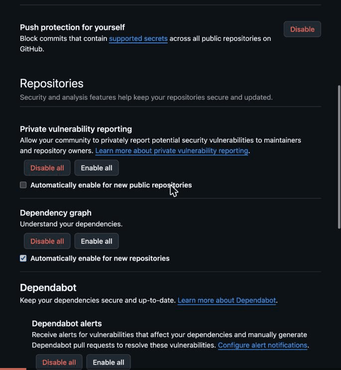

# Tutorial: GitHub Account Hygiene

A one-sitting pass over a personal GitHub account that is also a member of an
employer organization. The goal: work mail goes to the work inbox, personal
mail stays personal, and nothing holds access to the account that is not in
use today — without risking a lockout.

Everything here is in the GitHub web UI; none of it has an API. Recordings sit
next to the steps they show (`assets/github-account-hygiene/`).

## Ground rules

- **Audit before you change.** Read every settings page first, write down what
  you intend to change, then change it.
- **Never weaken sign-in.** Do not remove a 2FA method until a replacement is
  configured *and* tested (see [step 7](#7-two-factor-authentication)).
- **Employer integrations are not yours to prune.** Apps, tokens and keys the
  employer organization depends on stay, even if you have never used them.
- **Check what an app touches before removing it.** An installed app is wired
  to repositories; look at which ones and whether anything (deploys, required
  checks) depends on it.
- **Expect sudo mode.** GitHub asks for a passkey or 2FA code before sensitive
  pages (authorized GitHub Apps, recovery codes, uninstalls). It lasts a few
  hours per browser session.

## 1. Route notifications by organization

Settings › Notifications › **Default notifications email** = your personal
address. Then **Custom routing** › **Add new route** › pick the employer
organization › pick your verified work address › **Save**.

Organizations without a route keep using the default. The work address must be
added and verified under Settings › Emails first. If the employer restricts
notification email to its own domains, a route to a work address is the only
way to receive that organization's email at all.

## 2. Emails: backup address and privacy

Settings › Emails:

- **Backup email address** — pick a *personal* address. "Allow all verified
  emails" lets password resets go to the work address, which you lose when you
  leave the job.
- **Keep my email addresses private** — on. Your address leaves your public
  profile and web edits/merges use `ID+user@users.noreply.github.com`.

> **Trap:** turning on privacy also switches on **Block command line pushes
> that expose my email**. With it on, every push whose latest commit is
> authored with your real address is rejected — including the platform repos,
> which commit as `mike@just3ws.com`. Turn it off unless you switch every
> clone to the noreply address.

## 3. Personal access tokens

Settings › Developer settings › Personal access tokens. Delete classic tokens
that never expire. Replace the ones still needed with **fine-grained** tokens
that have an expiry and only the repositories they need.



Deleting a token cannot be undone; whatever used it stops working until it
gets a new one.

## 4. Organizations

Settings › Organizations. **Leave** organizations you no longer work with
(outside-collaborator access lingers for years). Only an admin of that
organization can add you back.

## 5. Authorized OAuth apps

Settings › Applications › **Authorized OAuth Apps**. Keep only what you use
now — for most people, **GitHub CLI**. Open each other app and **Revoke
access**.



"Never used" can still mean "used only for Sign in with GitHub". Revoking is
safe: the service simply asks you to authorize again next time.

## 6. Authorized and installed GitHub Apps

Settings › Applications:

- **Authorized GitHub Apps** (sudo) — revoke everything except the apps you
  use and the ones your employer's work depends on (for example its CI app,
  even if it shows "Never used").

  

- **Installed GitHub Apps** — open **Configure** on each. Note the repository
  access, then check those repositories: recent pushes, deployments by the
  app's bot, required status checks, workflow references. Uninstall only when
  nothing depends on it.

  ```sh
  gh api repos/OWNER/REPO --jq .pushed_at
  gh api 'repos/OWNER/REPO/deployments?per_page=3' --jq '.[] | {created_at, creator: .creator.login}'
  gh api repos/OWNER/REPO/branches/BRANCH/protection --jq .required_status_checks
  gh api repos/OWNER/REPO/commits/HEAD/check-runs --jq '.check_runs[].app.slug'
  ```

  

- **Permission update requests** — read the list before accepting. Declining
  keeps the app's current permissions. Prefer narrowing an app to **Only
  select repositories** over granting it more.

## 7. Two-factor authentication

Settings › Password and authentication. The safe order:

1. **Download recovery codes** (sudo) and store them in your password manager.
   Do not click *Generate new recovery codes* unless the old ones leaked — it
   invalidates them.
2. Add a second factor you can't lose with a single device: **GitHub Mobile**,
   and a **second passkey** on another device.
3. Only then remove **SMS**. GitHub flags it as the weakest method
   (SIM swap, phishing).

## 8. Code security defaults and noise

Settings › Code security: turn on push protection for yourself, Dependabot
alerts and security updates for new repositories, **Grouped security updates**
(one PR per ecosystem instead of one per alert) and private vulnerability
reporting for new public repositories. Settings › Notifications: turn off
**In-product messages** (marketing).



## 9. Signing keys and vigilant mode

Settings › SSH and GPG keys: every machine that commits needs its key added as
a **Signing Key**, not only an authentication key — see
[commit-signing.md](commit-signing.md). Leave **Vigilant mode** off until every
machine signs; it marks all past unsigned commits as *Unverified*.

## Checklist

- [ ] Default notification email personal; employer organization routed to work address
- [ ] Backup email personal; email privacy on; push blocking off
- [ ] No classic or non-expiring tokens
- [ ] Stale organizations left
- [ ] Only in-use OAuth apps and GitHub Apps; employer integrations kept
- [ ] Recovery codes in the password manager; second passkey and GitHub Mobile before dropping SMS
- [ ] Security defaults on; marketing mail off
- [ ] Every committing machine has a signing key
