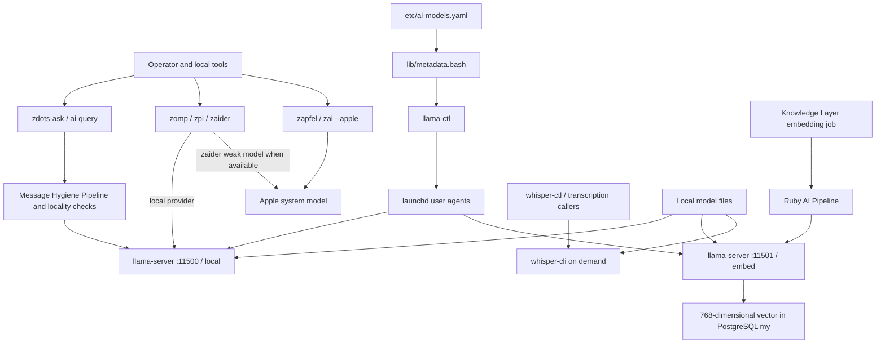

# Local Model Architecture and Implementation

This reference explains how zdots selects and runs local models. The inventory
below is evidence from **2026-11-22, 23:15 UTC**, on the home Apple M4 Mac
(10 CPU cores, 16 GiB unified memory, macOS 27.0.1 arm64). It is a dated
observation, not a live health report or a default for every host.

Use [Local AI Routing Layer](local-ai.md) for domain prompts and
[llama.cpp](llama-cpp.md) for lifecycle operations. Configuration authority is
[etc/ai-models.yaml](../etc/ai-models.yaml); loaded state comes from the running
process and its HTTP metadata.

## Runtime architecture



Provenance: [llama-ctl](../bin/llama-ctl),
[shell provider loading](../conf.d/95-ai.zsh),
[AI submission](../lib/ai-query-lib.bash),
[Ruby embedding job](../lib/zdots/jobs/embed.rb), and
[Apple integration](../providers/tools/apple-fm.zsh).
The diagram shows the local paths; explicitly selected cloud lanes are outside
this view. Validate the Mermaid locally with `make docs-diagrams`; GitHub render
inspection is a separate publishing check.

The two llama.cpp instances are independent Platform Services. Chat does not
provide embeddings in the audited configuration. Apple inference uses the
OS-managed `system` model; Aider can start a temporary loopback `fm serve`
process for its weak model. Whisper runs as a transcription command rather
than a permanently loaded chat server. Colima is not required for these native
model runtimes.

## Configuration and lifecycle implementation

| Responsibility | Implementation | Contract |
|---|---|---|
| Profile registry | [ai-models.yaml](../etc/ai-models.yaml) | Model filenames, source repositories, context sizes, defaults, chat and embedding startup settings |
| Profile resolution | [metadata.bash](../lib/metadata.bash), [llama-ctl](../bin/llama-ctl) | Merge `server` defaults with the selected profile; explicit `ZDOTS_AI_PROFILE` wins; `llama-ctl` also selects `default_profile_work` in work context when the variable is unset |
| Shell bindings | [llama-cpp.zsh](../providers/ai/llama-cpp.zsh), [95-ai.zsh](../conf.d/95-ai.zsh) | Export resolved model/endpoint information and lazily load tool functions |
| Download and integrity | [model-store.bash](../lib/model-store.bash), [trusted manifest](../lib/llama-models.sha256) | Download model files and verify SHA256; a manifest mismatch fails; unpinned downloads need an upstream digest unless explicitly allowed unverified |
| Service lifecycle | [llama-ctl](../bin/llama-ctl), [sandbox policy](../etc/llama-server.sb) | Build startup arguments and register launchd jobs; use the sandbox policy when available |
| Runtime discovery | [llama-caps implementation](../cmd/zdots-core/internal/llamacaps/llamacaps.go) | Summarize Capability and configuration information; corroborate limits with live metadata |
| Speech configuration | [whisper-ctl](../bin/whisper-ctl), [Whisper provider](../providers/ai/whisper-cpp.zsh) | Resolve the Whisper profile and invoke `whisper-cli` with the selected local file |

Chat profile defaults are `qwen3-8b` at home and `work-light` at work. Merely
declaring a profile does not download or load its weights. GGUF storage defaults
to `~/.local/share/llama-cpp/models`, overridable with `ZDOTS_AI_MODELS_DIR`.
Whisper uses `~/.local/share/whisper-cpp/models`, overridable with
`ZDOTS_WHISPER_MODELS_DIR`; its profile override is `ZDOTS_WHISPER_PROFILE`.

The launchd labels are `com.zdots.llama-server` and `com.zdots.llama-embed`.
Their plists live in `~/Library/LaunchAgents/`; logs default to
`~/.local/state/zsh/llama-server.log` and `llama-embed.log`.
The plist contains resolved startup flags. Editing YAML alone does not change
the running process: `llama-ctl server install` regenerates and reloads chat;
`llama-ctl embed install` does the same for embeddings. These are mutations,
not inspection commands. Ordinary lifecycle control belongs to `zsvc` /
`llama-ctl`, rather than direct launchd manipulation.

Integrity behavior depends on the operation. Downloads can use Hugging Face's
published digest when a manifest entry is missing; no digest fails unless
`ZDOTS_MODEL_ALLOW_UNVERIFIED=1` explicitly permits an unverified file. Offline
service-start verification has no upstream repository argument, so an unlisted
file passes with a note. Successful startup alone is not proof of a trusted
fingerprint match.

## Caller paths and safety ownership

| Entrypoint | Local model selection and implementation |
|---|---|
| `zdots-ask`, default `zai` | Domain prompt selection followed by `ai-query`; see [zdots-ask](../bin/zdots-ask) and [router.zsh](../providers/tools/router.zsh) |
| `ai-query`, shared shell inference helpers | OpenAI-compatible chat submission; [ai-invoke.bash](../lib/ai-invoke.bash) owns shared inference hygiene and [ai-query-lib.bash](../lib/ai-query-lib.bash) checks the actual endpoint at submission |
| Local `zomp` | `default`, `plan`, `slow`, and `smol` all select `llamacpp/local`; see [omp.zsh](../providers/tools/omp.zsh) and [local model definition](../etc/omp/models.local.json) |
| Hybrid `zomp` | Keeps `smol` local; other roles can use explicitly selected cloud lanes. Role names do not identify extra local weight files |
| `zpi` | Local Pi provider configuration by default; see [pi.zsh](../providers/tools/pi.zsh) |
| `zaider` | Main model uses local llama.cpp. Prefers Apple `openai/system` for the weak model; falls back to its local weak configuration. `ZDOTS_AIDER_WEAK=local` skips Apple; see [aider.zsh](../providers/tools/aider.zsh) |
| `zapfel`, `zai --apple` | Guarded Apple one-shot path pinned to `--model system`; see [apple-fm.zsh](../providers/tools/apple-fm.zsh) |
| Knowledge Layer embeddings | [Pipeline.embed](../lib/zdots/ai/pipeline.rb) sends alias `embed` through the dedicated [HTTP adapter](../lib/zdots/ai/client.rb) to port 11501 |
| `whisper-ctl` | Default Whisper `standard` profile selects large-v3-turbo; `max-accuracy` selects large-v3 |

`ai-query --apfel` is a separate optional HTTP route to port 11434 with model
name `apple-foundationmodel`; it is not the direct `fm --model system` path.
No such server was observed in the audit. Similarly, a loopback broker can
route to remote providers: the address alone does not identify where inference
runs.

Shell one-shot paths use the Message Hygiene Pipeline: normalize, then apply
the PHI Scrubber before inference. The shared [AI boundary](../lib/ai_boundary.bash)
rejects disabled inference and disallowed endpoints in local mode. Local mode
permits loopback and RFC-1918 endpoints; the audited servers bind loopback.
The [Ruby Pipeline](../lib/zdots/ai/pipeline.rb) separately gates and applies its
PHI Scrubber before chat or embedding requests.

Interactive agent wrappers have launch-time guards and their own provider
connections. They do not send every turn through the shell one-shot Message
Hygiene Pipeline. Do not interpret a local provider configuration as proof of
per-turn content filtering. The local model audit did not exercise interactive
sessions or cloud lanes.

The embedding job starts with 1,200-character chunks, splits again on recognized
context-overflow errors, and combines multiple chunk vectors with a component
mean followed by L2 normalization. A single vector passes through unchanged.
It writes the result to the record's PostgreSQL `my` embedding column. Character
count is a performance hint, not an exact token budget.

## Audited model inventory: 2026-11-22

The host had `ZDOTS_CONTEXT=home`, `ZDOTS_AI_MODE=local`, and
`ZDOTS_AI_PROFILE=qwen3-8b`. Both llama.cpp endpoints were healthy. Their live
build was **b12359-b1b770d90**; the installed Whisper CLI reported **1.9.5**.

| Model | Observed state | Format | Exact file bytes | Configured source repository |
|---|---|---|---:|---|
| Qwen3-8B | Loaded chat model, alias `local` | GGUF v3, Q4_K_M | 5,027,784,224 | `bartowski/Qwen_Qwen3-8B-GGUF` |
| Nomic Embed Text v2 MoE | Loaded embedding model, alias `embed` | GGUF v3, Q8_0 | 512,225,120 | `nomic-ai/nomic-embed-text-v2-moe-GGUF` |
| Whisper large-v3-turbo | Installed, selected transcription default; no transcription process observed | GGML, header file type 1 | 1,624,555,275 | `ggerganov/whisper.cpp` |
| Whisper large-v3 | Installed, optional `max-accuracy`; no transcription process observed | GGML, header file type 1 | 3,095,033,483 | `ggerganov/whisper.cpp` |
| Apple Foundation Model `system` | `fm available` reported available; no `fm` server observed | OS-managed | Not established | OS-managed |

The four ordinary weight files total **10,259,598,102 bytes (9.555 GiB)**.
This excludes Apple's managed assets and runtime/KV memory. File modification
times are filesystem metadata, not model release or download dates.

### Chat and embedding model metadata

| Metadata | Qwen3-8B | Nomic Embed Text v2 MoE |
|---|---|---|
| Filename | `Qwen_Qwen3-8B-Q4_K_M.gguf` | `nomic-embed-text-v2-moe.Q8_0.gguf` |
| Architecture | `qwen3` | `nomic-bert-moe` |
| Runtime-reported parameters | 8,190,735,360 | 475,288,320 |
| Blocks / attention heads | 36 / 32; 8 KV heads | 12 / 12 |
| Hidden / output dimensions | 4,096 hidden | 768-dimensional embeddings |
| Vocabulary | 151,936 | 250,048 |
| GGUF and runtime context | 32,768 tokens | 512 tokens |
| Embedded license | `apache-2.0` | `apache-2.0` |
| Parallel slots | 1 | 1 |
| Batch / physical batch | 2,048 / 2,048 | 2,048 / 2,048 |
| K / V cache types | `q8_0` / `q8_0` | `f16` / `f16` |
| Requested GPU layers | 99 | 99 |
| Other startup settings | Flash Attention on; cache reuse 256; temperature 0.4; reasoning off | Embeddings enabled; mean pooling; no warmup |

Qwen's live sampling defaults additionally reported top-k 40, top-p 0.95,
min-p 0.05, and `n_predict=-1` (no fixed generation cap). Callers may set their
own limits and temperature. The chat server reported text input/output, no
vision/audio/video, no speculative draft, and no LoRA entries.

Nomic metadata declares eight experts with two selected and the size label
`8x277M`. That label is not the runtime's parameter count; retain both fields
without inferring an active parameter count from the label.

### File fingerprints and provenance

Paths below are relative to the respective model directories above. SHA256
was calculated over each entire file during the audit.

```text
54fffa050078e984116639c83dfb64b5aa6d4cd474e018b076777c632bbccccd  Qwen_Qwen3-8B-Q4_K_M.gguf
06e7a7e594a26985523c18383aba4aad39fe6e14f08ffc6ab5b554e1ccdc3cff  nomic-embed-text-v2-moe.Q8_0.gguf
1fc70f774d38eb169993ac391eea357ef47c88757ef72ee5943879b7e8e2bc69  ggml-large-v3-turbo.bin
64d182b440b98d5203c4f9bd541544d84c605196c4f7b845dfa11fb23594d1e2  ggml-large-v3.bin
```

Both GGUF digests matched the tracked trusted manifest. The Whisper digests
are observed fingerprints: neither file is pinned in that manifest, and the
audit did not compare them with an independent upstream digest. The registry
records repository names, not immutable upstream revisions.

Apple exposes the selector `system` and availability through this CLI, but
the inspected commands did not establish its exact revision, parameter count,
quantization, file path, or weight size. Aider's Apple metadata assigns 6,144
input and 2,048 output tokens; these are configured client budgets, not a
measurement of the model's native context window.

### Declared alternatives that were absent

The inspected stores contained none of these registry candidates: `qwen3-14b`
(Qwen3-14B), `standard` (Qwen2.5-Coder-7B-Instruct), `llama-3.1`
(Meta-Llama-3.1-8B-Instruct), `constrained` (Qwen2.5-Coder-1.5B-Instruct),
`work-light` (Qwen3-4B-Instruct-2507), or `work-light-phi`
(Phi-4-mini-reasoning). Their registered GGUF variants use Q4_K_M.
The Qwen3-0.6B draft was absent and `draft_model_file` was commented out.
Whisper `light` (small.en) was also absent.

Ollama and MLX executables were installed, but no matching running model
processes or weights were found in their inspected standard stores. An
installed runtime is not evidence that another model is in use.

## Known limits and refreshing the evidence

**Embedding context discrepancy:** `llama-caps` advertised 2,048 embedding
tokens from physical batch size. Nomic's GGUF metadata and running server both
reported a 512-token context. Batch capacity does not establish model context.
The Ruby embedding job already handles context overflow by splitting input.
This audit did not test long-input behavior or change Capability reporting.

**Configuration versus runtime:** `llama-ctl server config --json` resolves
intended settings. Compare it with the process arguments and live `/props`
before claiming those settings are loaded. `/v1/models` tensor sizes differ
from complete file sizes; the inventory reports filesystem byte lengths.

Read-only starting points:

```sh
llama-ctl server config --json
llama-ctl server status --json
llama-ctl embed status --json
llama-ctl model-list
llama-caps --json
whisper-ctl config
whisper-ctl model-list
/usr/bin/fm available
```

For an exact refresh, corroborate these summaries with GET `/v1/models` and
`/props` on both loopback servers, model process arguments, GGUF/GGML headers,
and whole-file SHA256. Do not send inference prompts merely to inventory
models. In a restricted execution environment, failed socket probes can mean
access restrictions; the original audit confirmed health outside the sandbox.

Coverage included the configured llama.cpp/Whisper directories, standard
Hugging Face, Ollama, MLX, LM Studio and Jan stores, `~/models`, model-trial
cache, and the checked Dock_1TB model paths. It was not an arbitrary full-disk
scan or a historical inference-usage audit. No secrets, prompt histories,
patient material, or model inference requests were needed.
