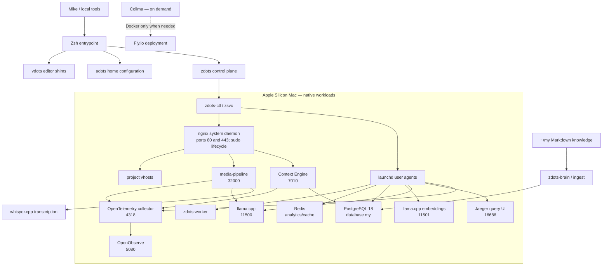
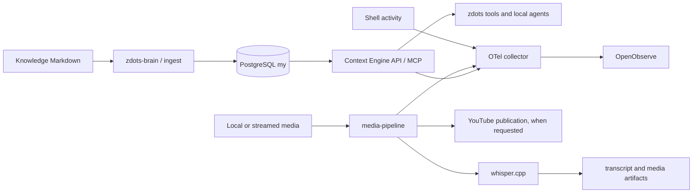

# Platform Map

This map records the component boundaries of Mike's personal OS and the local
projects that depend on it. It separates tracked configuration, runtime
services, data stores, and externally hosted workloads. Runtime state is a
snapshot; use the listed status commands before acting.

## Ownership

| Component | Location | Responsibility | Git / lifecycle boundary |
|---|---|---|---|
| **zdots** | `~/.config/zsh` | Zsh environment, command catalog, service registry, local AI and observability control | Normal Git repo; `zdots-ctl` and `zsvc` manage services |
| **adots** | `~/.homegit` bare repo; work tree `$HOME` | User-level configuration and dotfiles | Use `adots` / `adots-git`; never treat it as a normal work-tree repo |
| **my** | `~/my` | Private Knowledge Layer source documents and Context Engine app | Normal Git repo; Markdown vaults are authoritative, PostgreSQL is derived/searchable state |
| **vdots** | `~/.config/nvim` | Neovim configuration and editor command shims | Normal Git repo; `~/.config/nvim/bin` is on the shell PATH |
| **media-pipeline** | `~/github.com/just3ws/media-pipeline` | Video intake, transcription, media workflow, and publication | Separate Rails app; local Puma on `127.0.0.1:32000` |
| **WWWorkRemote** | `~/github.com/wwworkremote/wwworkremote` | Personal job-search and synthesis app | Separate project; local Rails route is documented in the URL map |
| **Hallway** | `~/github.com/just3ws/hallway` | Family coordination app | Separate project; not part of the always-on host service plane |
| **Phalanx Duel** | `~/github.com/phalanxduel/game` and related repos | Game rules, web client, and demo/deploy surfaces | Local development runs on bare metal; Fly deployment uses its remote build path |
| **Portfolio** | `~/github.com/just3ws/just3ws.github.io` | Static personal site and generated résumé exports | Local nginx serves built output; it has no request-time app backend |

## Runtime topology



## Service roles and authority

| Layer | Component | Authority / use |
|---|---|---|
| Lifecycle | `zdots-ctl` | Starts/checks the platform in dependency order |
| Lifecycle | `zsvc` | Controls individual registered services; nginx is handled by `nginx-ctl` through its sudo boundary |
| Local inference | `llama-ctl` / llama.cpp | Chat endpoint at `127.0.0.1:11500`; embeddings at `127.0.0.1:11501` |
| Audio | `whisper-ctl` / whisper.cpp | Preferred local transcription engine; invoked by media workflows as needed |
| Knowledge | `zdots-brain` / Context Engine | PostgreSQL database `my`; Markdown sources remain authoritative; use `zdots_ro` for safe ad-hoc queries |
| Async work | `zdots-worker` | Drains the `my` job queue |
| Telemetry | OTel collector → OpenObserve | Collector accepts OTLP on `4318`; OpenObserve stores and queries telemetry on `5080` |
| Trace inspection | Jaeger | Local trace UI on `16686` |
| Cache/analytics | Redis | Local buffer/cache on `6379`; not the Knowledge Layer source of truth |
| Local routing | nginx + mkcert | HTTPS `*.localhost` routes to zdots and project backends; configuration ownership is split by repo |
| Agent coordination | `bus` | Durable human/agent coordination CLI; the optional bus coordinator is parked |
| Containers | Colima | Installed, Kubernetes disabled, VM stopped/deleted; keep off unless a workflow needs Docker |

For exact vhosts, owners, and upstreams see [Local URL Routing](local-url-routing.md).
For startup order and launchd registrations see [Platform Service Plane](platform-service-plane.md).

## Data paths



| Data | Authority / retention rule |
|---|---|
| Knowledge documents | Files under `~/my` are the source; the database is an index and application store |
| Database access | `zdots_ro` is for SELECT-only exploration; app writes use the documented application boundary; migrations use the migration identity |
| Ingest source files | Durable source material; hygiene reports age but does not delete it |
| Transcription | whisper.cpp is the chosen engine; preserve original camera/media files and treat Drive cache internals as managed by File Provider |
| Telemetry | Local collection; OpenObserve home retention is three days; inspect ingest volume before changing retention |
| AI boundary | Local inference by default; PHI Scrubber and locality gates apply before inference |
| Archives | `/Volumes/Dock_1TB/zdots-archive` holds private local archives and provenance; never commit or upload it |

## PATH ownership

The shell assembles PATH in layers. For a machine-wide static executable
directory, add it in `env.sh` §9, where `_zdots_path_add` validates and
deduplicates entries. Keep provider-owned paths in their provider functions,
and repo-local `bin/` switching in `conf.d/08-local-bin.zsh`.

| Source | Entries / behavior |
|---|---|
| `.zshenv` | Establishes `ZDOTDIR`, loads POSIX `env.sh`, normalizes Zsh's unique `path` array |
| `env.sh` §9a | System, Homebrew-linked, Go, Cargo, Bun, pnpm, and other machine-wide paths |
| `providers/pkg/homebrew.zsh` | Homebrew `bin` and `sbin` through `zdots_pkg_manager_paths` |
| `providers/node/mise.zsh` | Mise shims through `zdots_node_runtime_paths` |
| `env.sh` §9c | User CLI paths: zdots, vdots, `~/.local/bin`, optional app shims, and `~/bin` |
| `conf.d/01-zdots-bin.zsh` | Ensures zdots commands are available during interactive startup |
| `conf.d/08-local-bin.zsh` | Adds/removes a repository's `bin/` when changing directories; this is intentionally dynamic |
| `.zshenv.local` / `.zshrc.local` | Optional machine-local overrides; audit separately from tracked defaults |

Audit the current Zsh order and command resolution with:

```zsh
print -rl -- $path
whence -va <command>
```

The current PATH issue Z-282 concerns launchd/cwd-dependent shell resolution;
the interactive list above does not prove every launchd process has the same
PATH. Use explicit `WorkingDirectory` and a controlled service PATH for
launchd consumers.

## Operational snapshot — 2026-10-31

`zdots-ctl status`, `capabilities --json`, and the read-only database probe
showed the core platform healthy: OpenObserve, Jaeger, OTel, llama.cpp,
embeddings, PostgreSQL 18.6, Redis, and the worker were reachable. nginx was
loaded and listening. Colima was down by design. Internal storage reported
about 51 GiB free; `/Volumes/Dock_1TB` had about 342 GiB free.

Current commands:

```bash
zdots-ctl status
zdots-ctl check
capabilities --json
zsvc list
zdots-storage
zdots-hygiene              # preview only
```

## Related maps

- [zdots service plane](platform-service-plane.md)
- [local URL routing](local-url-routing.md)
- [local AI and knowledge boundaries](local-ai.md)
- [media ingestion pipeline](ingest-media-pipeline.md)
- [OpenObserve retention and operations](openobserve.md)
- [platform repo synchronization](agents/platform-sync.md)
- Context Engine schema map: `~/my/context-engine/docs/architecture/system-map.md`
- Hallway schema map: `~/github.com/just3ws/hallway/docs/architecture/system-map.md`
