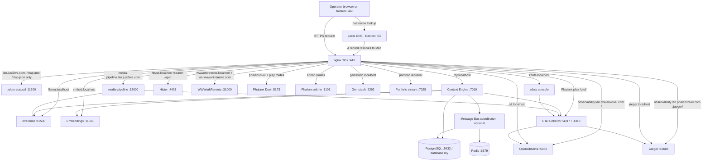

# System Atlas

The System Atlas is the read-only, LAN-facing map of the local system. Open
[`https://lan.just3ws.com`](https://lan.just3ws.com) on the trusted local
network, or use [`https://zdots.localhost/map`](https://zdots.localhost/map)
on this Mac. The LAN root redirects to `/map`.

## Visual model

The map uses a **connectionist topography**: nodes are things an operator can
visit or diagnose; links are runtime dependencies or request routes. The page
starts at the network edge and moves inward through routing, applications, and
shared infrastructure. The areas are neighborhoods, not deployment tiers or
trust boundaries. Select a node to see its owner, process, port, manager, live
signal, URL, and immediate connections.

This combines a 10,000-foot orientation view with drill-down links to the
system's existing consoles:

- `zdots.localhost` for the Observable Control Plane, manuals, docs, command
  help, and local diagnostics.
- `my.localhost/panoramic` for Context Engine Panoramic View and runtime
  observations; `/platform` shows service health.
- `media-pipeline.lan.just3ws.com` for media intake, transcription, and
  publication operations.
- `lan.wwworkremote.com` and `lan.phalanxduel.com` for the project-owned
  WWWorkRemote and Phalanx Duel LAN routes.
- `observability.lan.phalanxduel.com` for OpenObserve at `/` and Jaeger at
  `/jaeger/`.
- `o2.localhost` and `jaeger.localhost` for telemetry and trace inspection.

The topology catalog is [`etc/system-topology.json`](../etc/system-topology.json).
It records ownership, links, hostnames, process, port, lifecycle manager, and
coordinates in one place. Coordinates are hand-tuned for readability. Update
the catalog and this page together when ownership, routing, or dependency
relationships change.

Atlas node ownership describes the subsystem or project boundary represented
by that node. Across the portfolio, the canonical owner identity is Mike Hall
(`just3ws`, `mike@just3ws.com`). Project brands and repository organizations
remain intact. UGtastic and WHOIS Tech Community are historical names for the
same community and oral-history project; its current YouTube integration uses
the configured `@whoistechcmty` channel handle, while Patreon-era
`whoistechcmty` is a legacy identifier. See the [Platform Map](platform-map.md)
for project lineage and current focus.

The node panel also shows active LAN hostnames, candidate shared aliases,
concrete nginx path-to-upstream routes, and graph connections. A candidate
alias is an inventory/planning aid; it does not imply that nginx serves it.

## Hostname families and route detail

The shared system uses `*.localhost` on this Mac and the intended one-label
`*.lan.just3ws.com` family on the trusted LAN. The shared LAN family is
partial: `lan.just3ws.com` serves this Atlas and
`media-pipeline.lan.just3ws.com` serves media-pipeline; other candidate aliases
appear on their app nodes but do not have nginx routes yet. Wildcard DNS
resolves a name to the Mac, but a matching nginx virtual host and certificate
SAN are still required.

Phalanx Duel retains its project-owned `*.phalanxduel.localhost` and
`*.lan.phalanxduel.com` conventions. Its map entry includes game, play, admin,
demo, telemetry, and RUM paths, plus the separate
`observability.lan.phalanxduel.com` gateway shared by OpenObserve and Jaeger.
WWWorkRemote retains its project-owned `.localhost` aliases and
`lan.wwworkremote.com` route. Neither project is renamed into the shared
`lan.just3ws.com` family.

Route metadata names nginx paths and loopback upstream ports, including
static nginx-served pages and path-specific bridges. The graph then shows each
application's connections to shared data, inference, and telemetry systems.
Configured routes and current process/health observations remain separate.

## Reading live state

`/map.json` is a small, read-only snapshot derived from `zsvc list`,
`zdots-ctl status --json`, application `/up` routes, and the six root `VERSION`
markers. The page refreshes it every 30 seconds. It includes a timestamp,
summary counts, coarse process state, boolean application health, and the
Astronomicon epoch for each versioned surface. The Atlas header highlights
missing or drifting markers, and versioned application nodes repeat their epoch
in the node card and detail panel. SwiftBar consumes the zdots marker; `my`
retains its separate `my.structure.v1` contract. The snapshot omits PIDs, logs,
disk paths, command output, backlog content, and diagnostic details.

The map separates three ideas:

- **Configured topology** means the relationship exists in the catalog.
- **Healthy / unhealthy** means a configured application or platform health
  check passed or failed.
- **Running / stopped** means `zsvc list` reports the process state when no
  stronger health signal is available.
- **Not checked / unobserved** means this status source does not report health
  or process state for that node. It does not mean the service is down.

Use `zdots-endpoints` to probe configured nginx URLs, `zdots-ctl status` for
the core platform, `zsvc diag <service>` for launchd and logs, and the linked
application consoles for application-specific checks. The System Atlas does
not start workers, run repairs, expose controls, or claim that a route works
because a node is drawn.

## Runtime layers



The catalog includes additional local endpoints such as Redis, Gemstash, the
async worker, optional Colima and Message Bus coordinator, and the static
portfolio.
`docs/platform-map.md`, `docs/platform-service-plane.md`, and
`docs/local-url-routing.md` provide the ownership, lifecycle, and hostname
views. For the media-pipeline cockpit, open
[media-pipeline.lan.just3ws.com](https://media-pipeline.lan.just3ws.com). Its
machine setup and recovery guidance is in the repository
[owner's manual](https://github.com/just3ws/media-pipeline/blob/main/docs/owners-manual.md).

The LAN map is reachable from a browser on the local network. Hostnames marked
as LAN routes are configured; unmarked `*.localhost` apps remain loopback-only
until their candidate alias is added to the owning nginx source, allowed by the
application if required, and included in the shared certificate.

## LAN route activation

The source vhost in `etc/nginx/servers/zdots.conf` exposes only `/`, `/map`,
and `/map.json` for `lan.just3ws.com`; all other paths return 404. It shares
the existing statusd backend but never exposes the wider `zdots.localhost`
route tree.

After reviewing the vhost, deploy tracked nginx sources and activate the
certificate through the existing privileged workflow:

```bash
nginx-regen-certs && nginx-ctl validate && nginx-ctl reload
```

`nginx-regen-certs` deploys tracked vhosts, regenerates certificate SANs, and
validates/reloads nginx. These commands may prompt for sudo.

The DNS wildcard configured for `*.lan.just3ws.com` should resolve the name to
this Mac. Confirm from a LAN client with `https://lan.just3ws.com/` and
`https://lan.just3ws.com/map.json`. `https://lan.just3ws.com/docs` must return
404. The vhost is active on this Mac; each LAN client still needs local DNS and
certificate trust for a warning-free connection.

## Maintenance contract

When the service inventory changes:

1. Update `etc/system-topology.json` with a source-backed owner, process,
   port, manager, health key, URL, and links.
2. Update the Mermaid and routing tables in `docs/platform-map.md`,
   `docs/platform-service-plane.md`, and `docs/local-url-routing.md` where the
   topology or ownership changed.
3. Update the relevant project's user guide and command `--help`/man page when
   an operator workflow changes.
4. Check the server and catalog syntax, run mandoc lint, and validate nginx
   after installing the source vhost:

   ```bash
   ruby -c bin/zdots-statusd
   ruby -rjson -e 'JSON.parse(File.read("etc/system-topology.json"))'
   mandoc -Tlint man/man1/zdots-statusd.1
   nginx-ctl validate
   ```
5. Rebuild graph artifacts through the repository's documented graphify
   workflow after code or topology changes; inspect generated diffs before
   committing them.

Runtime service state is a timestamped observation, not durable topology
documentation. Do not copy a live green/red state into the static maps.
